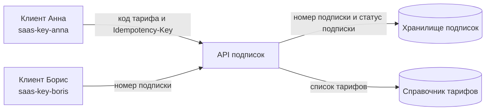

Студент: Пестов Никита Владимирович
Группа: ДЭ 16-25
Профиль: prb
Тема: saas
Статус: готово к защите

##Паспорт темы
1. Код темы: saas

2. Заказчик: выдуманный SaaS-сервис; учётные системы клиентов открывают и закрывают подписку в учебном биллинге, без личного кабинета на сайте

3. Кто вызывает: всё вызывает ключ клиента; клиентов несколько, у каждого свой ключ

4. Ресурсы: тарифы, подписки

5.Состояния: подписка активна → отменена

6.Четыре сценария: получить тарифы; создать подписку; получить свои подписки постранично; отменить подписку

7.Правило повтора: повтор создания с тем же Idempotency-Key возвращает ту же подписку и не открывает вторую; отмена возможна один раз

8.События: subscription.started, subscription.cancelled

9.Вне работы: настоящие списания, акты и налоги
Приёмка: второй вызов создания не открывает вторую подписку; чужой ключ её не видит; повторная отмена отклоняется

##Таблица «кто вызывает»

| Кто | Строка-ключ | Что ему можно | Что ему нельзя |
|---|---|---|---|
| Клиент Анна | saas-key-anna | смотреть тарифы, создавать и отменять свои подписки, видеть свои подписки | видеть подписки Бориса, отменять подписку Бориса |
| Клиент Борис | saas-key-boris | то же со своими подписками | создавать/отменять подписку Анны, видеть её подписки |

 ##Четыре сценария

| № | Сценарий | Что присылают | Что получают | Когда отказывают |
|---|---|---|---|---|
| 1 | Получить тарифы | ничего (или номер страницы) | список тарифов | — (публичный справочник, отказа нет) |
| 2 | Создать подписку | код тарифа и Idempotency-Key | номер подписки, статус «активна» | тариф не существует; повтор с тем же ключом — та же подписка, вторая не создаётся |
| 3 | Список своих подписок | номер страницы | только подписки этого клиента | чужой ключ |
| 4 | Отменить подписку | номер подписки | статус «отменена» | уже отменена — отклоняем |

##Схема

**1. Правило повтора.** Повторный вызов создания подписки с тем же Idempotency-Key не должен второй раз сработать прямоугольник «Хранилище подписок» — вторая подписка не создаётся, возвращается та же самая. Отмена тоже выполняется один раз: повторная отмена уже отменённой подписки отклоняется.

**2. Вне работы.** Настоящие списания, акты и налоги — **этого в моём API не будет**.

**3. Для профиля prb.** Успешный результат создания подписки (номер подписки и статус «активна») читает внешний прямоугольник «Клиент Анна» — учётная система клиента, которая получает ответ API.

